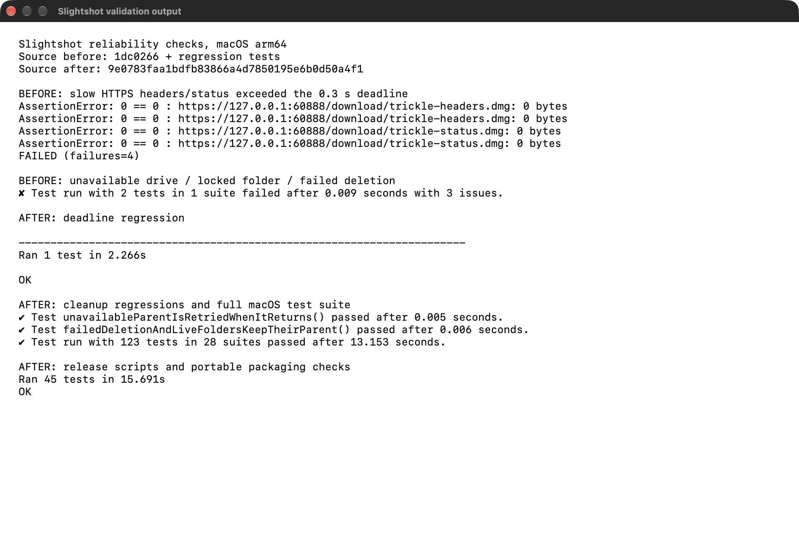

# Export cleanup and release download deadlines

Captured on macOS arm64 from source `9e0783faa1bdfb83866a4d7850195e6b0d50a4f1`.
These are internal changes. The screenshot shows actual validation logs in a
native AppKit window, using `capture.swift`. No app UI behavior changed.

Before source `1dc0266`, with the new regression tests applied, forgot the
staging parent when its drive was unavailable or a matching folder survived the
sweep. It also accepted an empty HTTPS response after the 0.3-second deadline
when a local TLS server trickled the status line or headers.

The cleanup fixtures rename a temporary parent to simulate an unavailable drive,
hold a real folder lock, and remove parent write permission to cause deletion to
fail. They restore access and verify the next sweep removes the abandoned folder
and its remembered parent. The HTTPS fixture tests both download and gate budgets.

Validation, separate from the screenshot:

- `swift test`: 123 tests passed, including both cleanup regressions.
- `python3 -m unittest discover -s Tests -v`: 45 tests passed.
- `swiftlint --strict --quiet` and `git diff --check`: passed.
- The release download gate uses a main-thread POSIX timer on the Linux and macOS
  release runners, covering status/header reads, redirects, body reads and retries.
  The handler and timer are cleared when the download returns or raises.

Raw output is preserved in the `*-before.txt` and `*-after.txt` files.
`validation.txt` is the focused excerpt displayed in the screenshot.
