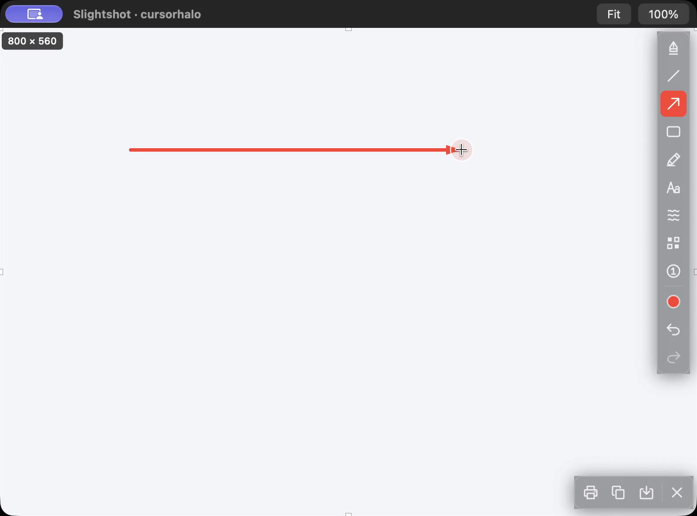
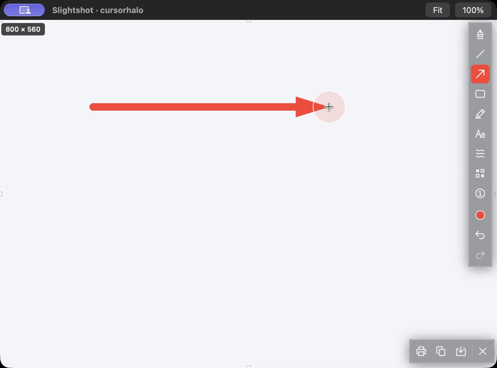
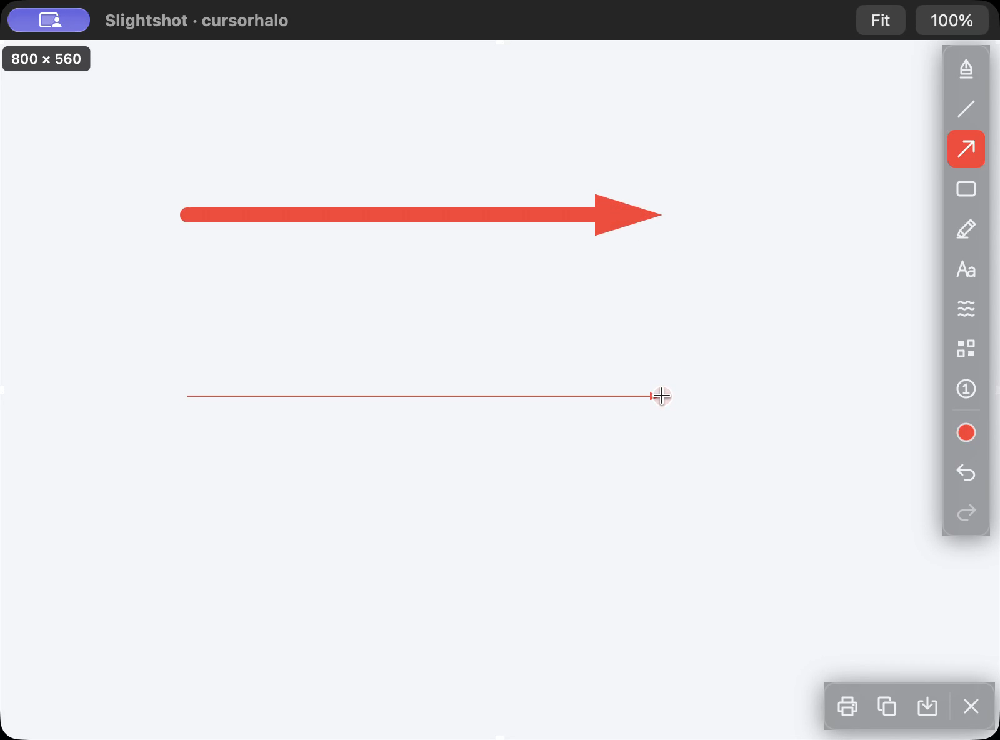
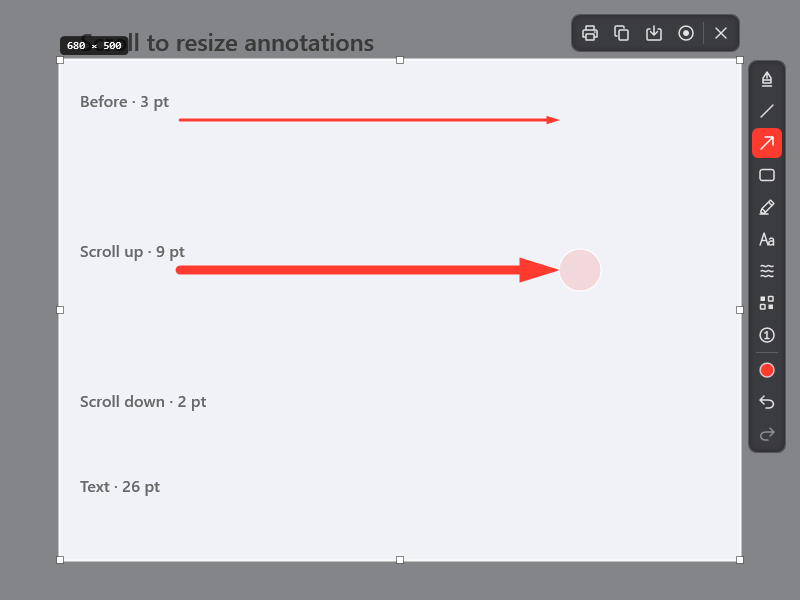
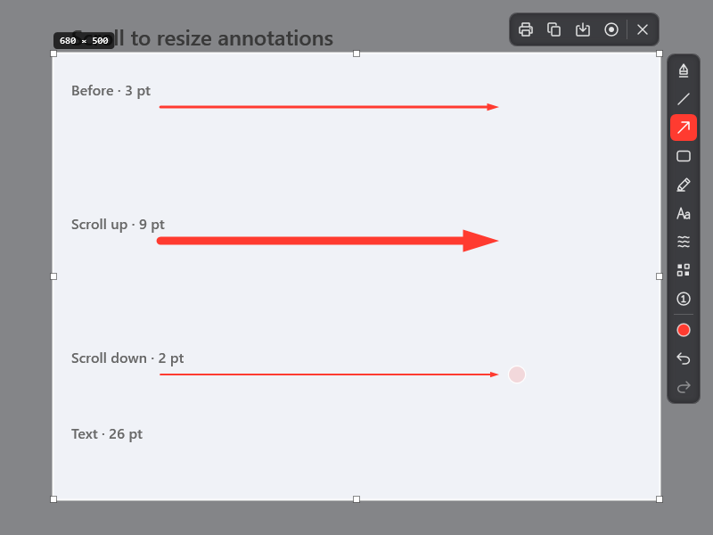
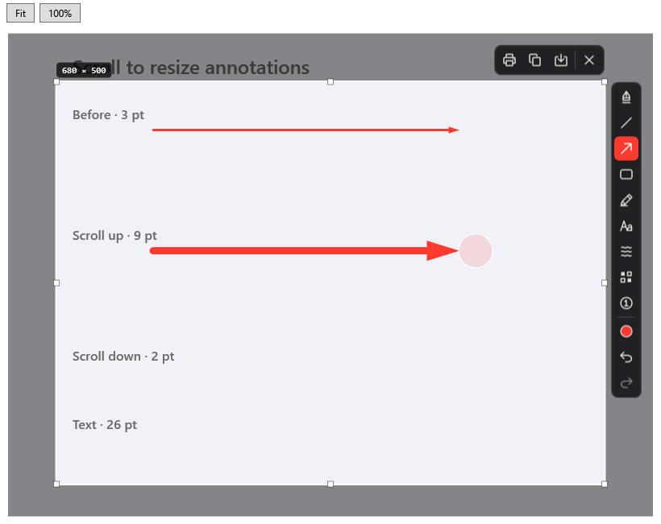
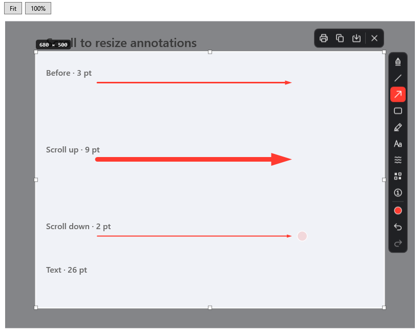

# Cursor halo review evidence

The selected option 3 uses a translucent coral circle with a white ring, centered on the pointer. Scroll up grows it; scroll down shrinks it. It follows pointer motion and disappears 1.2 seconds after the latest scroll. Size remains available to accessibility without visible text.

## macOS

Source: `1c0207efa6a34de7bdfa5344cc98d91669f58010`, macOS 27 / AppKit.

[Watch the native application recording](mac-preview.mp4). The untouched ScreenCaptureKit recording is [mac-native-source.mp4](mac-native-source.mp4). The preview uses 30 fps H.264 with fast start; its UI pixels are not redrawn. It shows a live arrow growing from 1 to 12 pt, a second arrow shrinking from 12 to 1 pt, text sizing and the halo disappearing.

This is the working clipboard editor with a synthetic 800×560 source. Automated mouse gestures and production scroll-handler calls drive it. The visible native crosshair is a fixture marker at the injected pointer coordinates; it is not a recording of physical mouse input. ScreenCaptureKit records only this native window, without desktop pixels or audio.

| Smaller | Larger | Shrunk |
| --- | --- | --- |
|  |  |  |

[Expired halo](mac-expired.png), [native control capture](cursor-halo-native-control.png), [fixture validation](validation.json), and [media QA](media-qa.json).

## Windows

Source: `5249790346d63a5c7accbccbe957ee9f23430314`, GitHub test merge of branch `1c0207e`. [Native Windows run](https://github.com/jmpijll/slightshot/actions/runs/38234038295).

These are native WPF controls rendered on Windows over a synthetic 800×600 image. Automated production scroll-handler calls and annotation factories exercise screenshot, loaded clipboard and video editors. There is no physical Windows mouse interaction in these captures. The halo is centered on injected source point (580, 270) when increased and (580, 420) when decreased; clipboard positions include the native viewport transform.

| Screenshot up, 9 pt | Screenshot down, 2 pt |
| --- | --- |
|  |  |

| Clipboard up | Clipboard down |
| --- | --- |
|  |  |

[Video canvas](windows-video.png), [screenshot text](windows-capture-text.png), [clipboard text](windows-clipboard-text.png), [screenshot before](windows-capture-before.png), [clipboard before](windows-clipboard-before.png), [native validation](windows-validation.json).

## Checks, separate from visual evidence

- Swift: 66 tests across 18 suites passed, including continuous halo scaling, pointer centering at edges, movement, hit testing and accessibility, plus existing scroll/history/draft/video checks.
- Windows core: 447 checks passed. Release cross-build: zero warnings or errors.
- Native WPF: centered geometry, pointer following, ring/fill transparency, input pass-through, no text children and accessible size passed. Screenshot/clipboard/video scroll fixtures and rendered annotation pixels passed.
- Strict SwiftLint, `git diff --check`, macOS release bundle and signature verification passed.
- Updated code was reviewed without critical or important findings.
- Full hosted workflows are linked from the PR. Media evidence supplements these checks.
