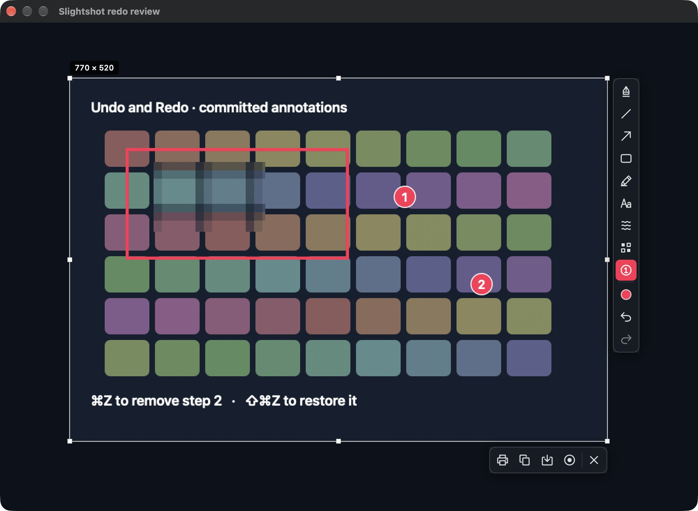
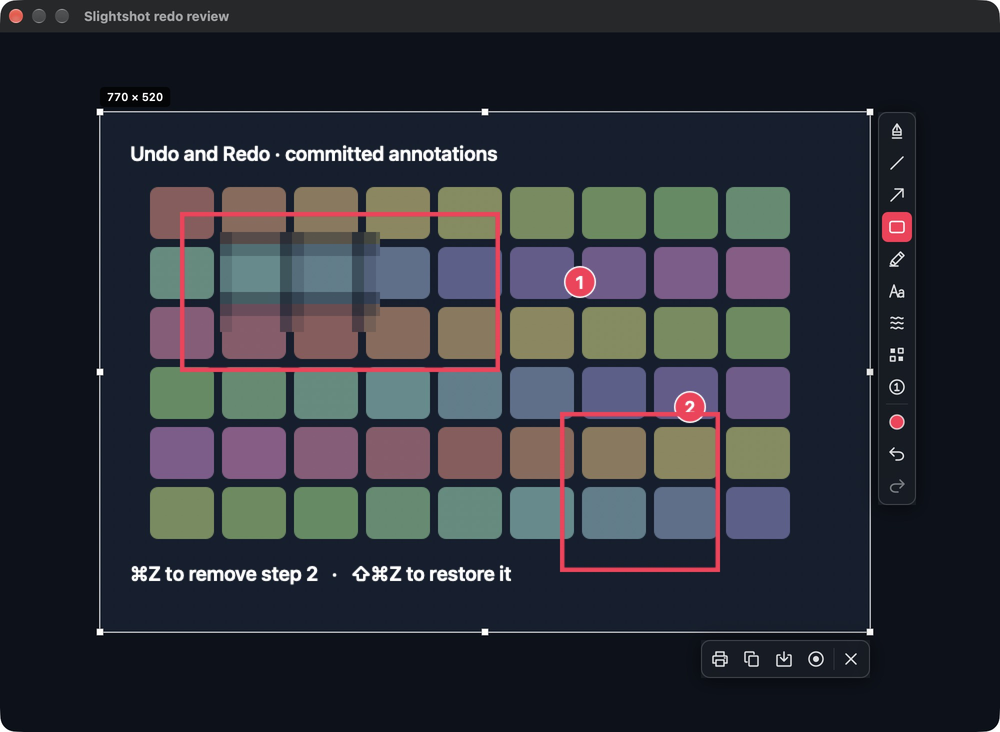
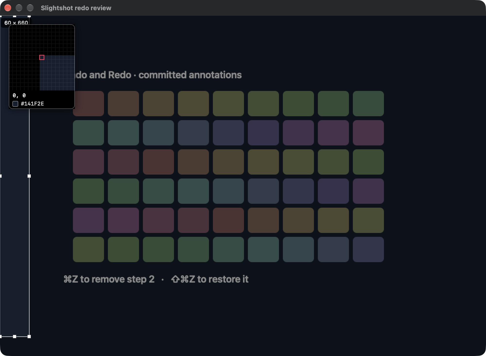
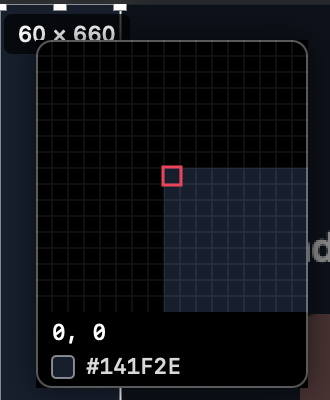

# Editor precision review (#44)

Native macOS window captures of the screenshot editor after the fix. They were
captured on 20 October 2026 on macOS 27.0.1 with a built-in Retina display.
The app bundle was built from `a53fc96` with `make app` and launched with
`open -n build/Slightshot.app --args --redo-review`. That bounded fixture runs
the production `OverlayView`, toolbars and magnifier over a synthetic 1000×700
source image. It starts with a 770×520 selection, a rectangle, a pixelation and
two numbered steps. It captures no desktop content.

[`drive.swift`](drive.swift) drove every interaction. It posts real HID mouse
events through `CGEvent`, finds the Rectangle button through Accessibility, and
captures the window with `screencapture -l` after each step. To rerun it, launch
the fixture and run `swift docs/review/editor-precision/drive.swift <output-dir>`.
The terminal running it needs Accessibility and Screen Recording access.

## A click outside the selection keeps the work

Before the click:

After a single click at (60, 660), below and left of the selection:

The two window captures are byte-identical PNGs (SHA-256 prefix
`d0e06758bd8ebce9` for both). Before this change, the click removed every
annotation and cleared Redo.

## Shift with Rectangle draws a square

The Rectangle button was clicked, then Shift was held while dragging from
(560, 380) to (720, 400). The new mark is a 160×160 square. Line and Arrow keep
their 45° snapping (covered by tests).

## The loupe at the display corner

The mouse was pressed outside the selection at (60, 660) and dragged to the
top-left corner (0, 0) without releasing. A drag past 4 points still starts a
new selection and discards the old annotations, as before. The loupe's centre
cell marks pixel (0, 0). The cells beyond the image edge are black instead of
the crop being stretched across the whole loupe.

Detail at full Retina resolution:

