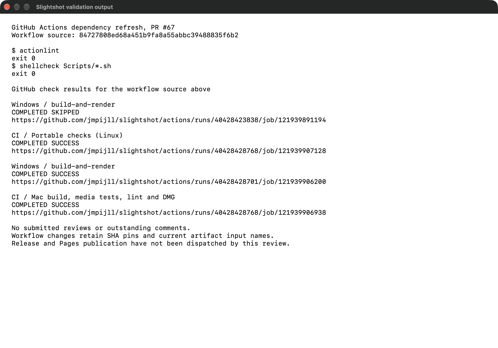

# GitHub Actions dependency refresh

This internal tooling change updates seven SHA-pinned GitHub Actions across the
CI, Windows, release and Pages workflows. It preserves their existing inputs and
artifact names. The checkout fork protections do not affect this repository's
`push`, `pull_request`, `workflow_dispatch` and `workflow_call` event usage.

The screenshot is a native macOS window displaying actual validation output.
Workflow source: `84727808ed68a451b9fa8a55abbc39488835f6b2`.
The original results and CI links are in `checks.json`; `validation.txt` is the
focused output shown in the capture.

Validation, separate from visual evidence:

- `actionlint`: passed.
- `shellcheck Scripts/*.sh`: passed.
- GitHub Linux portable checks: passed.
- GitHub macOS build, media tests, lint and DMG verification: passed.
- GitHub Windows build and native rendering checks: passed.
- No unresolved review threads or submitted change requests.

Release publication and Pages deployment were not dispatched by this review.
The capture shows recorded check results, not a new publication run. The evidence
commit adds only these review files; it does not change the validated workflows.
