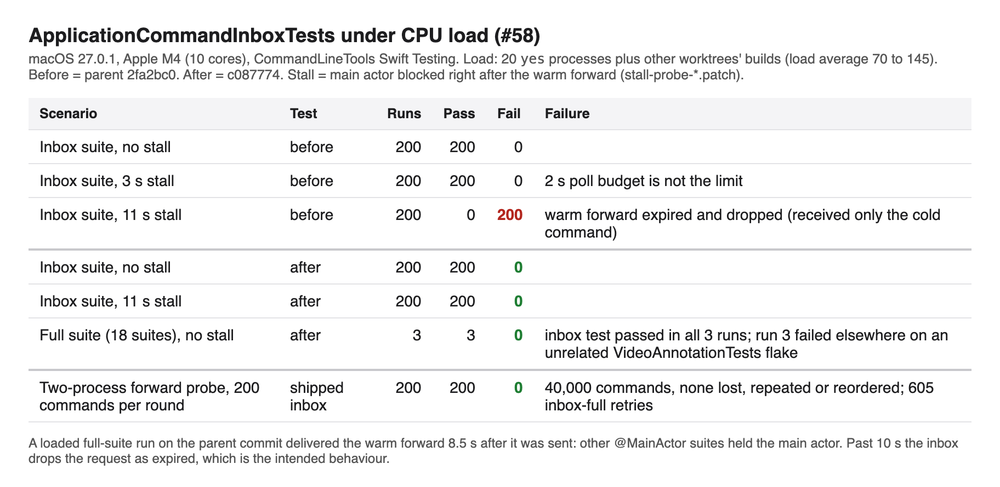

# Inbox warm-forward flake (#58)

`ownerReceivesColdAndWarmForwardedCommandsOnce` failed when the main actor was
stalled for more than 10 seconds between the warm forward and its delivery. The
owner received the command and then discarded it, because the test used the real
clock and the inbox drops requests older than 10 seconds. That expiry is
intentional (`expiredRequestsNeverStartDelayedCaptures`). Nearly every suite in
`SlightshotTests` is `@MainActor`, so under load one suite can hold the main
actor for seconds. One loaded full-suite run on this Mac delivered the warm
forward 8.5 seconds after it was sent.

The 2 second poll budget did not cause the failures. The dispatch source queues
its handler on the main queue before the first sleep resumes, so with a 3 second
stall the warm forward still arrives on the first poll.



## Reproduce

Build the tests with the toolchain in `CONTRIBUTING.md`, then:

```bash
git apply docs/review/inbox-forward/stall-probe-before.patch   # on the parent commit
swift build --build-tests ...
INBOX58_STALL_SECONDS=11 docs/review/inbox-forward/loaded-repeat.sh 200 8 20
```

`stall-probe-after.patch` adds the same stall to the fixed test. The stall
blocks the main actor right after the warm forward, as a long synchronous test in
another suite does. `loaded-repeat.sh` runs the inbox suite from the built bundle
with 20 `yes` processes loading the CPU.

`forward-probe.sh 200 200 20` builds a two-process probe from the shipped
`ApplicationCommandInbox.swift`. One process owns the inbox and receives on its
main queue, as the app does. The other forwards 200 numbered commands per round.
The owner fails a round if a command is lost, repeated or reordered.
