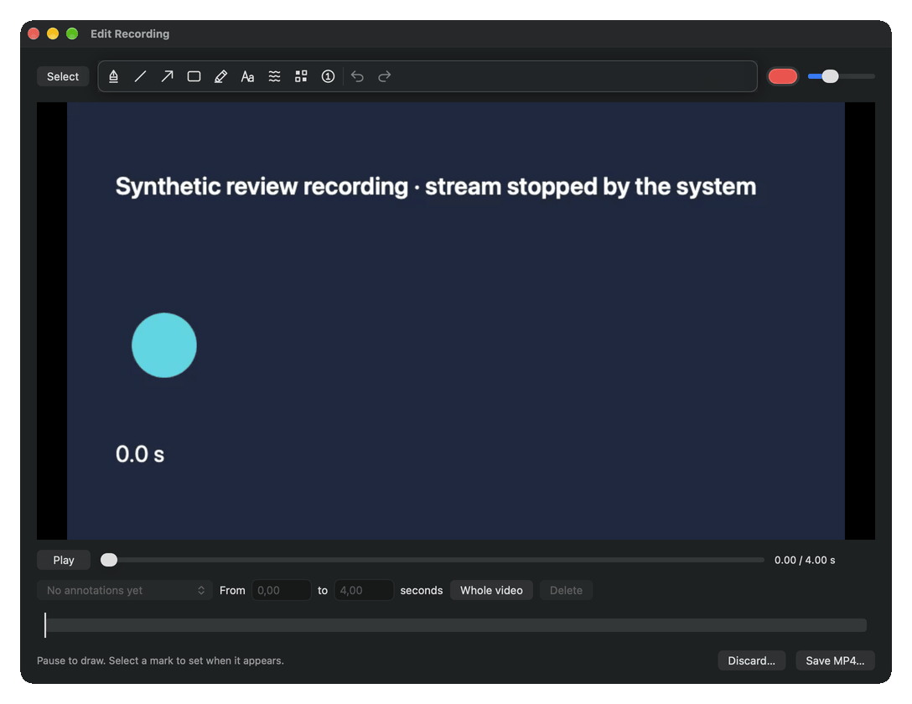
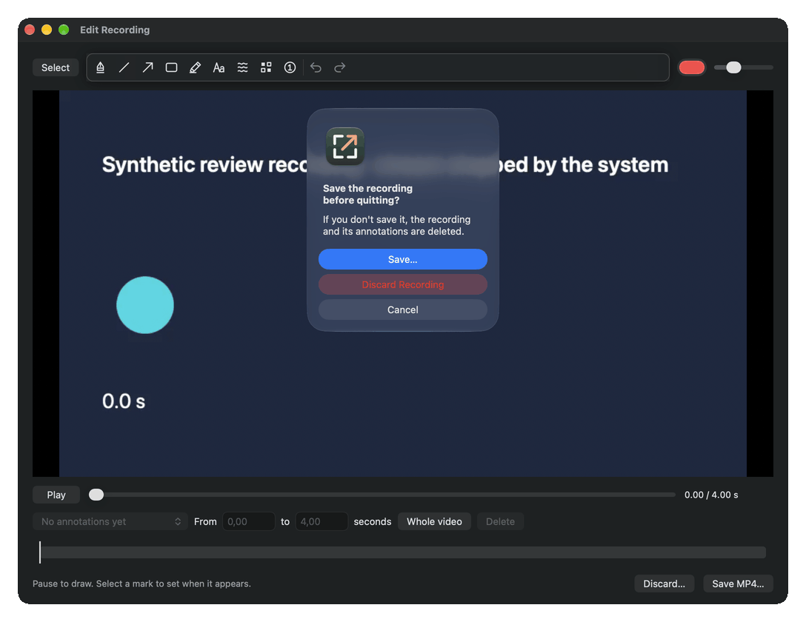
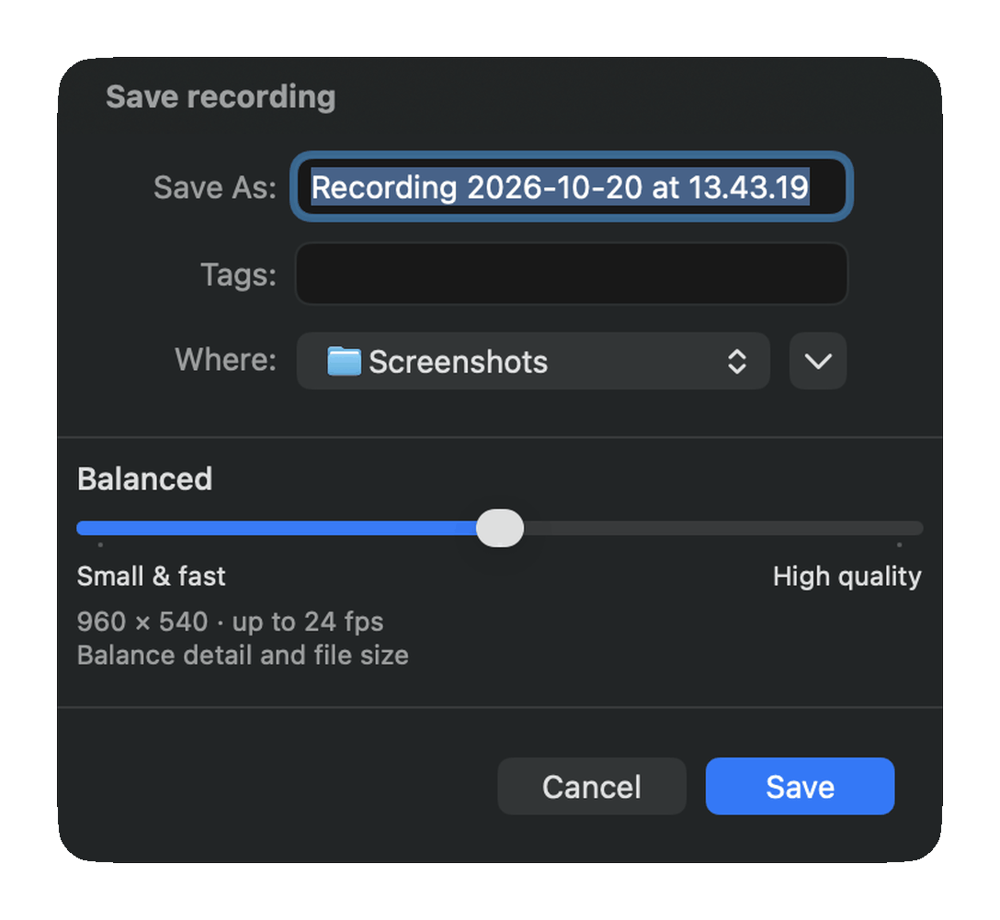

# Unsaved recording protection review

Captured on 20 October 2026 on macOS 27.0.1, Apple silicon, from source commit
`4ba9230e19a363c47392bba7f0c1deb6a1f8e87f` built as a Developer ID signed
`Slightshot.app` and started with `--lost-work-review`.

The fixture writes a synthetic four-second movie into a real
`ScreenRecordingSession` folder and simulates the ScreenCaptureKit callbacks.
The stream reports `didStopWithError` (user stopped) first, and the recording
output reports that it finished afterwards. Everything after that runs the
production code: the recording coordinator, the playability check, the video
editor, the quit guard and its prompt, and the save panel. Each quit is a real
`NSApplication.terminate` call. The fixture clicks the prompt and panel buttons
automatically. Captures include only Slightshot's own windows.

## Editor opens after a stream error

Before this change, the stream error would have deleted this recording.

## Quit prompt with an unsaved recording

The automated sequence:

1. Cancel. Slightshot keeps running, and the editor and temporary recording
   remain. A second quit request sent while the prompt is open is ignored.
2. Save…. The quit is cancelled and the existing save panel opens, shown
   below. A second quit while the panel is open is ignored. The fixture
   cancels the panel, and the editor returns. After a successful save,
   Slightshot quits again by itself.
3. Discard Recording. The temporary recording is deleted and Slightshot quits.

[validation.json](validation.json) records each step and check.

`--quit-guard-probe` is a headless check of the same guard in a real
`SlightshotApplication`. It sends repeated `terminate` calls and a reentrant
delegate request, like a logout quit event, during the prompt and during a
save. `UnsavedWorkTests` launches it, and its expected event order is checked
in CI.
