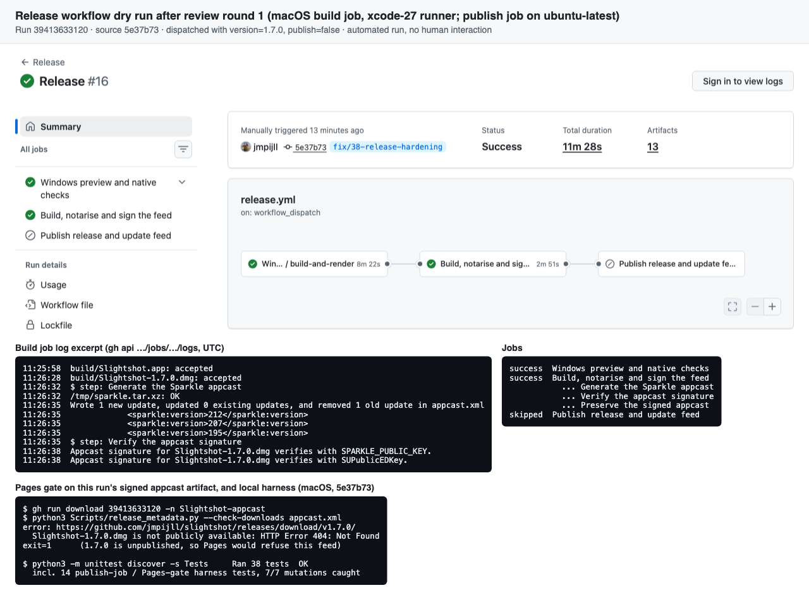
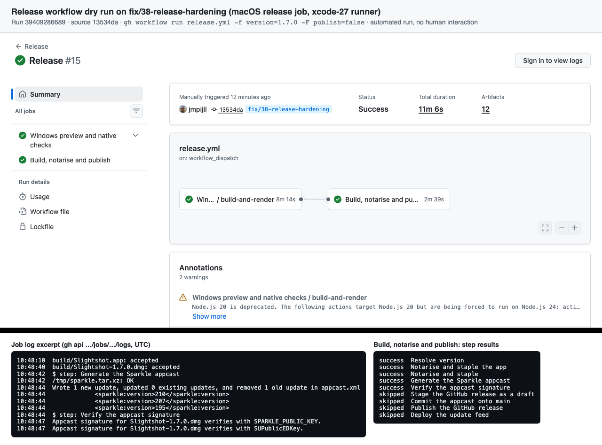

# Release workflow hardening (#38)

## After review round 1

[Release run 39413633120](https://github.com/jmpijll/slightshot/actions/runs/39413633120)
ran at source `5e37b73` with `version=1.7.0` and **publish** disabled. The macOS
build job notarised the app and disk image and checked the Sparkle download.
It signed build 212 into the feed fetched from `origin/main` and verified the
signature with both keys. It kept the signed feed as the `Slightshot-appcast`
artifact. The publish job was skipped. Run through the Pages gate, that
artifact is refused because 1.7.0 is not public.

- [dry-run-round1-log.txt](dry-run-round1-log.txt) is the job log excerpt, job and
  step results, artifacts, the gate refusal and the dispatch API response.
- [publish-harness.txt](publish-harness.txt) records the publish-job and Pages-gate
  tests and the workflow mutations they catch.

## First version

[Release run 39409286689](https://github.com/jmpijll/slightshot/actions/runs/39409286689)
at source `13534da`, before the publish job was split out.

- [dry-run-log.txt](dry-run-log.txt) is that run's job log excerpt.
- [local-checks.txt](local-checks.txt) records the Sparkle digest cross-check, the
  source gate, the first feed-commit harness and the signature check against
  wrong keys, a modified disk image and the public 1.6.0 download.
