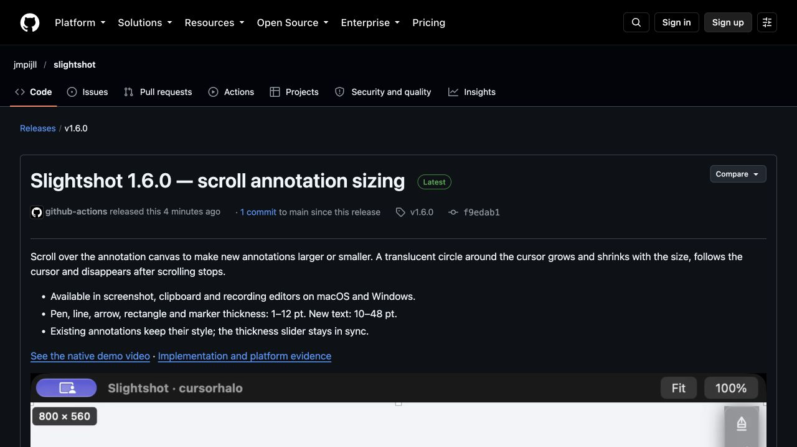

# Slightshot 1.6.0 release verification

[Release](https://github.com/jmpijll/slightshot/releases/tag/v1.6.0) · [Merged feature PR #37](https://github.com/jmpijll/slightshot/pull/37).

Release source: **f9edab1c9864d17a502ca589b67dd885cceda056**. Mac marketing version **1.6.0**, internal build **207**, derived from full source Git history. The release introduces scroll sizing and a circle centered on the cursor that grows or shrinks without visible text.

## Published downloads and updates

[Published-file validation](../v1.6.0-validation.json) independently checks all five downloaded public assets against their GitHub digests, sizes, versions and source provenance. The Mac app and DMG pass Developer ID signatures, stapled tickets, Gatekeeper and runtime linkage. The live feed matches the committed Pages deployment and authenticates the final DMG with the embedded Sparkle Ed25519 key, including the key from the immutable public 1.4.0 app. Previous 1.5.1/build 195 and 1.5.0/build 12 entries retain their signed enclosures.

The updated Homebrew cask fetched the final public DMG with its matching checksum through a temporary local validation tap. That tap was removed; no app was installed or replaced by these download checks.

## Native evidence

The exact release-tag Windows workflow renders actual WPF controls using synthetic 800×600 inputs and automated production scroll-handler calls. [Native validation report](windows-scroll-validation.json) identifies release source f9edab1. The fixture checks circle geometry, transparency, pointer following, input pass-through, accessible size and existing annotation/history/text/video behavior. It does not represent physical Windows mouse acceptance. Native ARM64 execution remains pending; ARM64 packages are cross-built and inspected.

| Screenshot larger | Screenshot smaller |
| --- | --- |
|  |  |

[Loaded clipboard](windows-scroll-clipboard-increased.png) · [Video canvas](windows-scroll-video.png).

[Native Mac video](../../cursor-halo/mac-preview.mp4) was captured from implementation source 1c0207e with automated input and a crosshair fixture marker. Product source is unchanged between that capture and the release; only release metadata and documentation differ. [Capture details and media QA](../../cursor-halo/README.md).

## Hosted checks

- [Final release](https://github.com/jmpijll/slightshot/actions/runs/38244709922): exact-tag native Windows checks, installers/portable archives, Mac signing/notarisation and publication passed. The initial attempt stopped before publication on a transient HTTP 504 fetching Sparkle; the failed Mac job was rerun successfully.
- [Final-source Mac/Linux CI](https://github.com/jmpijll/slightshot/actions/runs/38244702843): passed. Its first Mac attempt passed functional checks but failed artifact upload on DNS; the failed job was rerun successfully.
- [Live feed deployment](https://github.com/jmpijll/slightshot/actions/runs/38256414703): passed.
- Before merge, PR #37 passed all checks: 66 Swift tests, 447 Windows core checks, native Windows fixtures, Mac/Linux CI and review without critical or important findings. Release-script Python suite: 24 passed.

## Public release page

Live GitHub page captured through CUA after publication and adding the native demo. [Capture provenance](release-capture-source.json).

