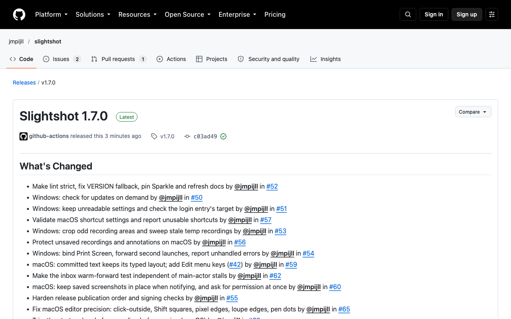

# Slightshot 1.7.0 release verification

[Release](https://github.com/jmpijll/slightshot/releases/tag/v1.7.0).

Release source: **c03ad49dbf1c19578d0cee0e10fb502a79e3b016**, annotated tag **v1.7.0**.
Mac marketing version **1.7.0**, internal build **350**, derived from full source
Git history. The release fixes the October audit issues and adds recording trim
on macOS and Windows.

## Published downloads and updates

[Published-file validation](../v1.7.0-validation.json) records independent
`shasum -a 256` checks of all five public assets against GitHub API digests and
sizes. The Mac version comes from the mounted app's `Info.plist`. Both portable
Windows apps report `1.7.0+c03ad49dbf1c19578d0cee0e10fb502a79e3b016` in their PE
ProductVersion. Both setup executables report `1.7.0` in their PE resources.

The Mac app and DMG pass `codesign --verify --deep --strict`, Gatekeeper
assessment and `xcrun stapler validate`. The DMG also passes `hdiutil verify`.
No app was installed or replaced during these checks.

The live [Sparkle feed](https://jmpijll.github.io/slightshot/appcast.xml) matches
`public/appcast.xml` on `main` at feed commit
`3cf1cc65cd8a6daaebe04bf595ce972ccf63ca95`. It contains 1.7.0/build 350 and retains
1.6.0/build 207 and 1.5.1/build 195. The public-download gate passes for all three
items. The exact-source release job verified the signed feed before publication.

The Homebrew cask points to the final public DMG with SHA-256
`3cf899fa552b241873499e84f52ddf8da61d2444a35367a878bded25c2e84b44`.
The cask passed a fetch and style check through an identical copy in a temporary
local tap. The tap was removed. Homebrew refused the original worktree path
for the style check because it requires casks to belong to a tap. All 44
release-script Python tests passed. The validation JSON records the commands.

## Native evidence

These links preserve the individual PRs' native captures and validation scope.
The linked records identify capture commits, synthetic fixtures and automated
interaction. Captures show the implementation revisions described there,
not a new manual acceptance run of the final release.

| Merged PR | Change | Review evidence |
| --- | --- | --- |
| [#50](https://github.com/jmpijll/slightshot/pull/50) | Windows update check, issue #48 | [Native Windows UI](../../windows-update-check/README.md) |
| [#51](https://github.com/jmpijll/slightshot/pull/51) | Windows settings and login target, issue #47 | [Native Windows settings](../../windows-settings/README.md) |
| [#52](https://github.com/jmpijll/slightshot/pull/52) | Strict lint, version fallback and docs, issue #39 | [Tool output and rendered docs](../../tooling-docs/README.md) |
| [#53](https://github.com/jmpijll/slightshot/pull/53) | Windows recording recovery and crop, issue #46 | [Native recording and output](../../windows-recording-robustness/README.md) |
| [#54](https://github.com/jmpijll/slightshot/pull/54) | Windows hotkeys, second launch and errors, issue #45 | [Native Windows captures and reports](../../windows-launch-hotkeys/) |
| [#55](https://github.com/jmpijll/slightshot/pull/55) | Release publication and signing checks, issue #38 | [Release dry run and publish validation](../../release-hardening/README.md) |
| [#56](https://github.com/jmpijll/slightshot/pull/56) | Unsaved Mac work protection, issue #40 | [Native quit and recovery](../../lost-work/README.md) |
| [#57](https://github.com/jmpijll/slightshot/pull/57) | Mac shortcut validation, issue #43 | [Native shortcut settings](../../shortcut-validation/README.md) |
| [#59](https://github.com/jmpijll/slightshot/pull/59) | Mac text layout and Edit keys, issue #42 | [Native text editing and exports](../../text-tool/README.md) |
| [#60](https://github.com/jmpijll/slightshot/pull/60) | Mac save notifications, issue #41 | [Native notification and save captures](../../save-notification/) |
| [#62](https://github.com/jmpijll/slightshot/pull/62) | Inbox warm-forward test, issue #58 | [Measured forwarding results](../../inbox-forward/README.md) |
| [#63](https://github.com/jmpijll/slightshot/pull/63) | Mac recording trim, issue #49 | [Native Mac editor, video and exports](../../video-trim/README.md#macos-evidence) |
| [#64](https://github.com/jmpijll/slightshot/pull/64) | Windows recording trim, issue #49 | [Native Windows editor and reports](../../video-trim/) |
| [#65](https://github.com/jmpijll/slightshot/pull/65) | Mac selection and pixel precision, issue #44 | [Native editor interactions](../../editor-precision/README.md) |
| [#69](https://github.com/jmpijll/slightshot/pull/69) | Version preparation, issue #68 | Metadata-only PR; [packaged PE version checks](../v1.7.0-validation.json) |
| [#71](https://github.com/jmpijll/slightshot/pull/71) | Staging bookkeeping concurrency, issue #70 | [Measured before and after results](../../70-staging-bookkeeping/loaded-repeat.png) |

## Hosted checks

- [Exact-tag release run](https://github.com/jmpijll/slightshot/actions/runs/39454650082) at `c03ad49` passed Windows native checks and packaging, Mac build and notarisation, feed signing, and release publication.
- [Source Mac and Linux CI](https://github.com/jmpijll/slightshot/actions/runs/39450459815) at `c03ad49` passed both jobs.
- [Live feed deployment](https://github.com/jmpijll/slightshot/actions/runs/39456626532) at `3cf1cc6` passed the public-download gate and deployment.

Local post-release checks and their commands are recorded in the validation
JSON. Review screenshots are documentation evidence and do not replace checks.

## Known limitations

- Windows previews are unsigned.
- Windows Print Screen hotkey callback registration and detection passed on CI, without a physical key press.
- Windows ARM64 is cross-built and inspected only. Native ARM64 execution remains unverified.
- Real Windows sign-out and a real Sparkle install-and-relaunch were not exercised end to end.
- The local installer checks read the public setup executables' version resources. They do not extract or execute the installer payloads.

## Public release page

[Capture provenance](release-capture-source.json) identifies the source commit
and the unauthenticated public page captured after publication.

