# Scrollwheel annotation sizing

Issue [#36](https://github.com/jmpijll/slightshot/issues/36).

Select Pen, Line, Arrow, Rectangle or Marker and scroll over the annotation canvas
to change thickness. Scroll up increases it; down decreases it. Text changes the
size of the next note. A transient indicator beside the pointer shows the current
size. Existing annotations, draft text and Undo/Redo keep their original state.
Blur, Pixelate, Numbered steps and Select retain normal scrolling.

## macOS native evidence

Captured on macOS 27 on 12 October 2026 from source `0a2185d`. The native app
was built with `Scripts/bundle.sh`. An isolated review copy uses a separate bundle
identifier and an ad-hoc signature so the user's normal Slightshot session is
unaffected. The production editor, toolbar, scroll handler and renderer run over
a synthetic 800×600 image. No personal desktop image is used.

The automated review fixture creates a 3 pt arrow, scrolls up to 9 pt and draws
another arrow, then scrolls down to 2 pt and draws a third. Text is set to 26 pt
through the same scroll handler. These are native AppKit control renders from the
visible application, with automated handler calls at explicit canvas positions.

Before scrolling:

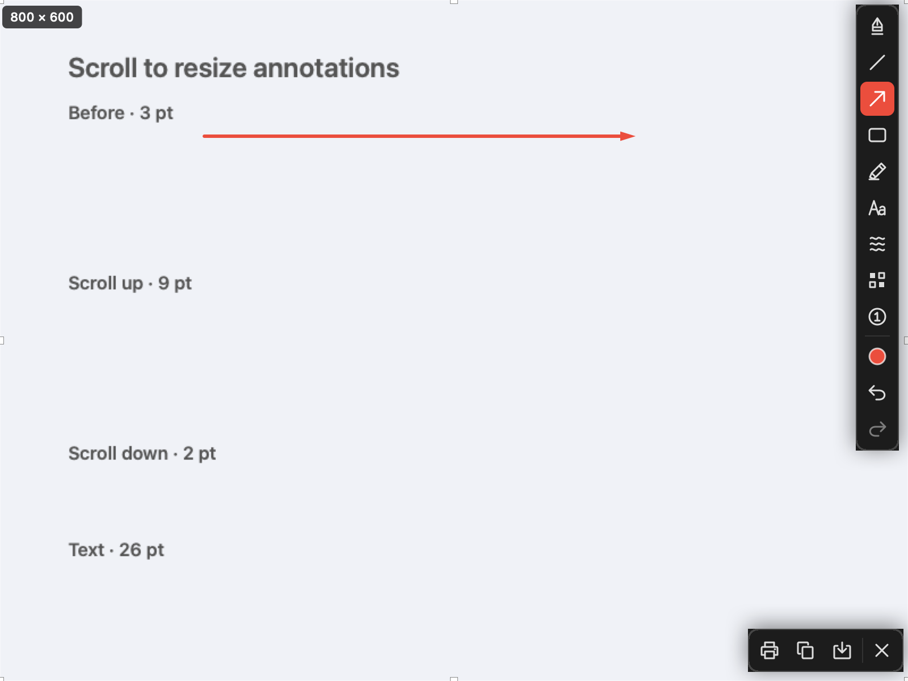

After increasing to 9 pt:

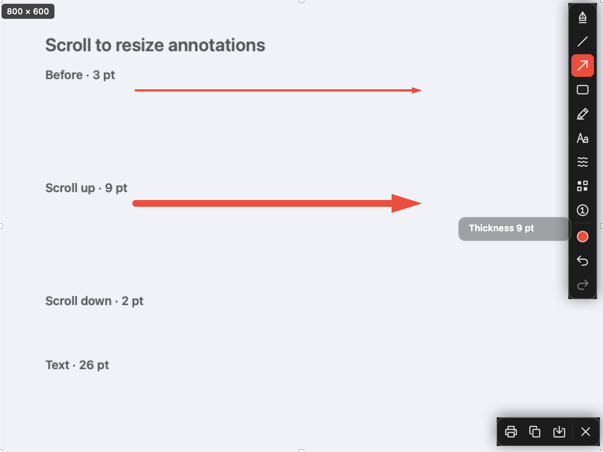

After decreasing to 2 pt:

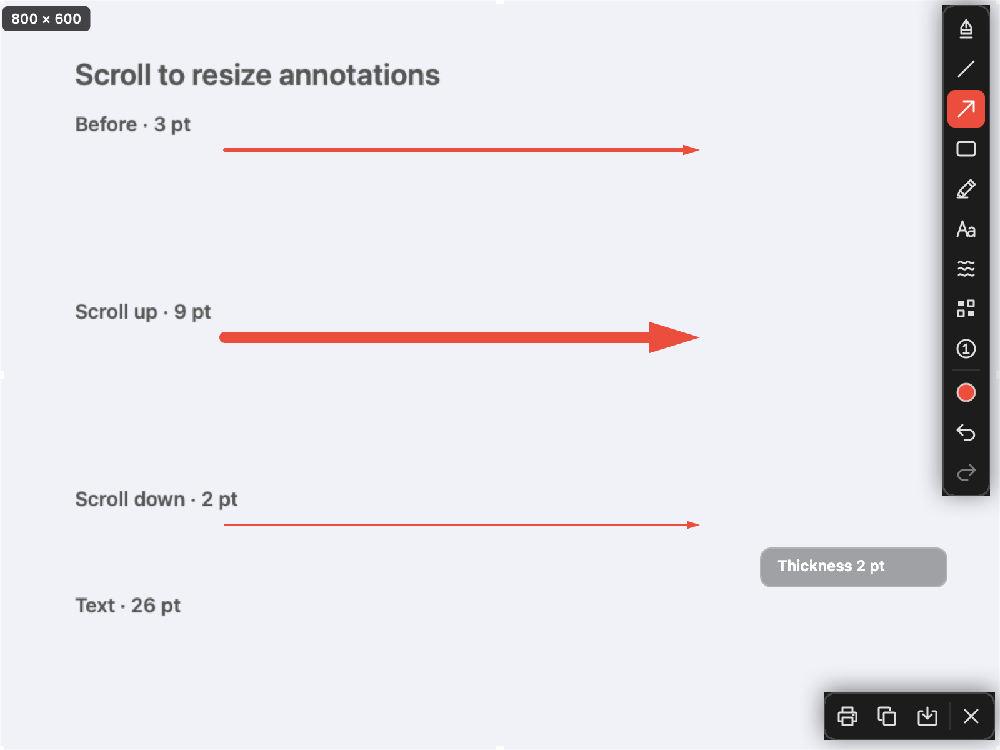

Text and the production video canvas:

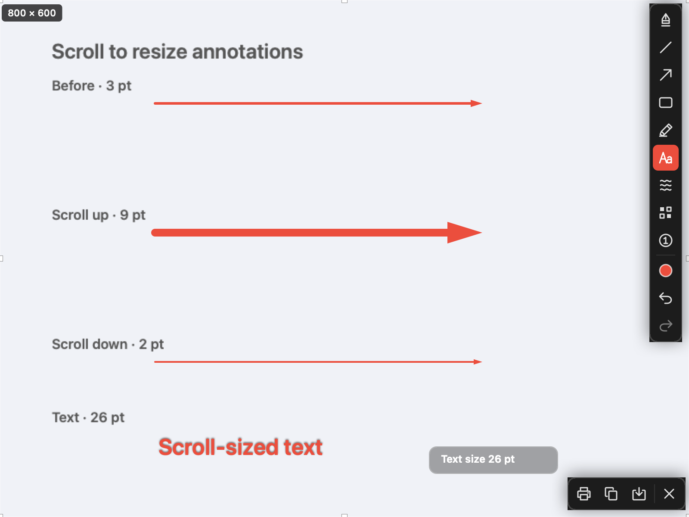

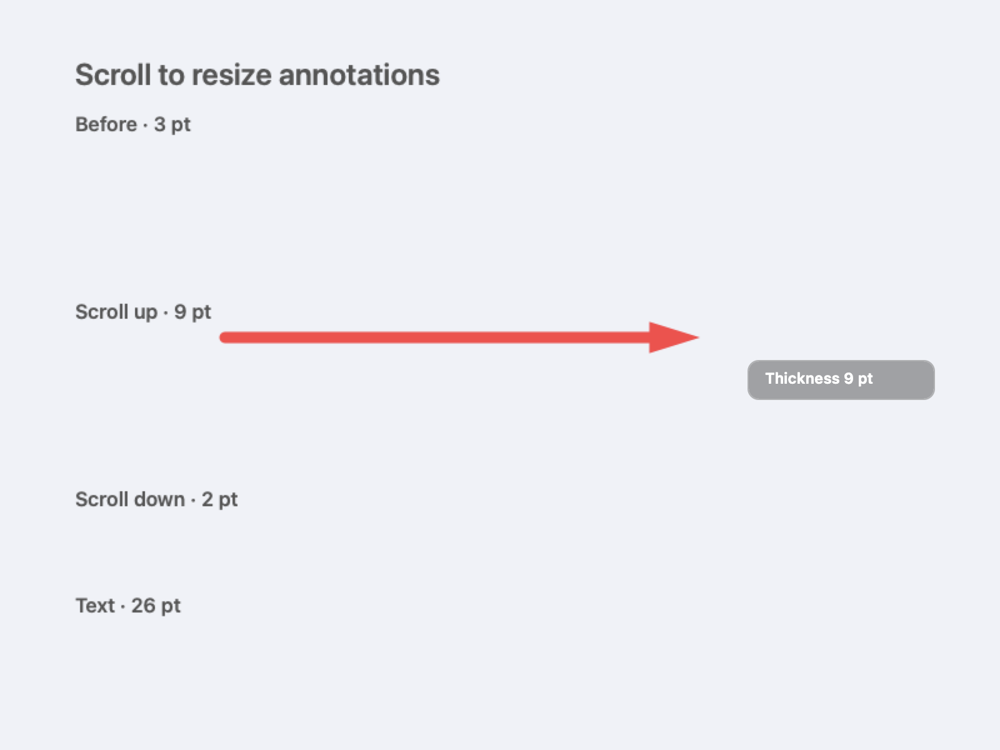

CUA additionally sends native scroll input through the actual clipboard window's
responder chain. Up increases the current thickness to 12 pt; down reduces it to
9 pt. With Text selected, up changes the next font size to 34 pt. The committed
arrows and text remain unchanged. These are cropped native window screenshots.

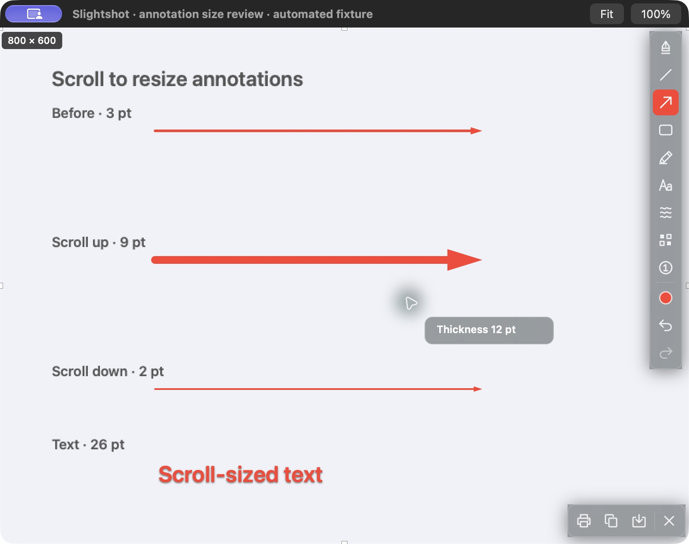


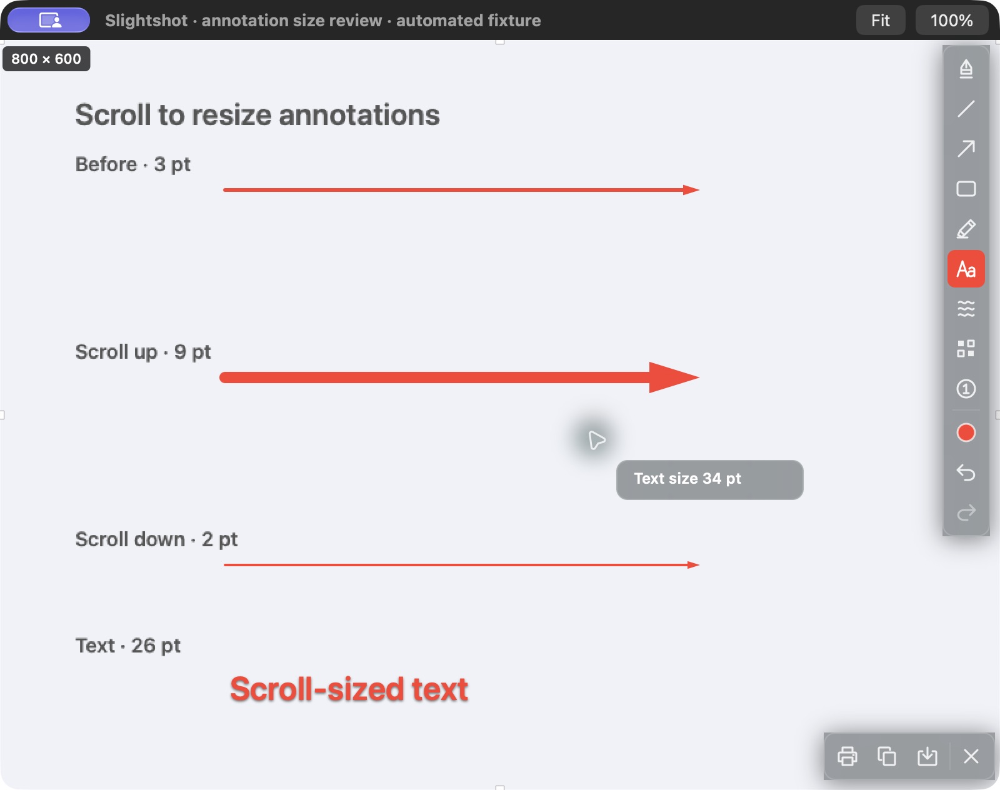

Reproduce the bounded fixture after building the bundle:

```sh
open -n build/Slightshot.app --args --annotation-size-review build/annotation-size-review
```

The fixture exits after five minutes, or through the editor Close action. It
does not capture the desktop, register global shortcuts or claim tray ownership.

## Windows native evidence

Source `c6c6c83` runs on the native Windows WPF runner in
[run 38214311104](https://github.com/jmpijll/slightshot/actions/runs/38214311104).
The subsequent macOS fixture correction changes no Windows code.

The fixture uses a synthetic 800×600 source and automated production scroll-handler
calls. Native WPF controls and the production annotation factories render the
3 pt, 9 pt and 2 pt arrows, 26 pt text, and the video canvas. It also verifies
unchanged original annotation widths, preserved Redo, draft text, fixed-size
tools, outside-selection scrolling and palette slider synchronization. This is
automated native validation; physical Windows mouse/trackpad acceptance was not
performed.

Before scrolling in the screenshot editor:

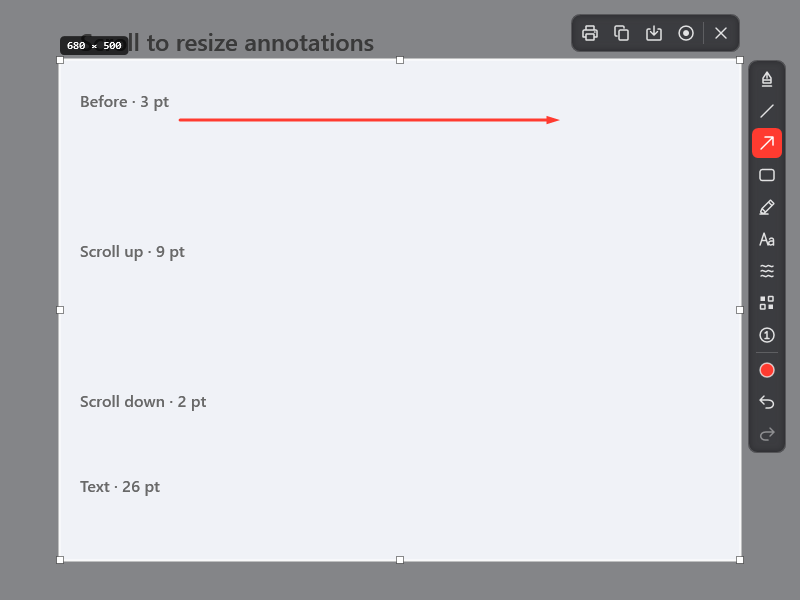

After scrolling up to 9 pt and drawing another arrow:

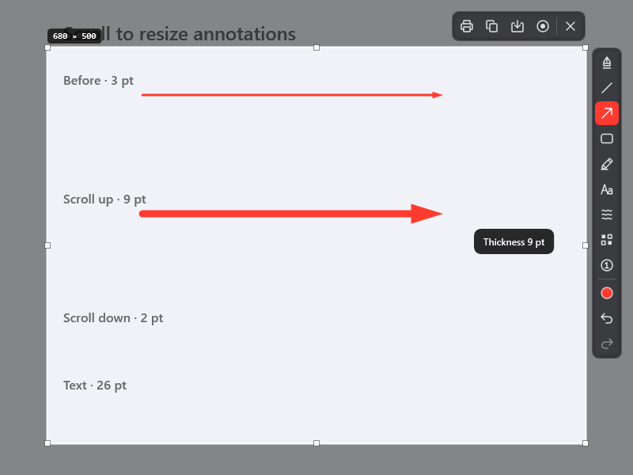

After scrolling down to 2 pt and drawing another arrow:

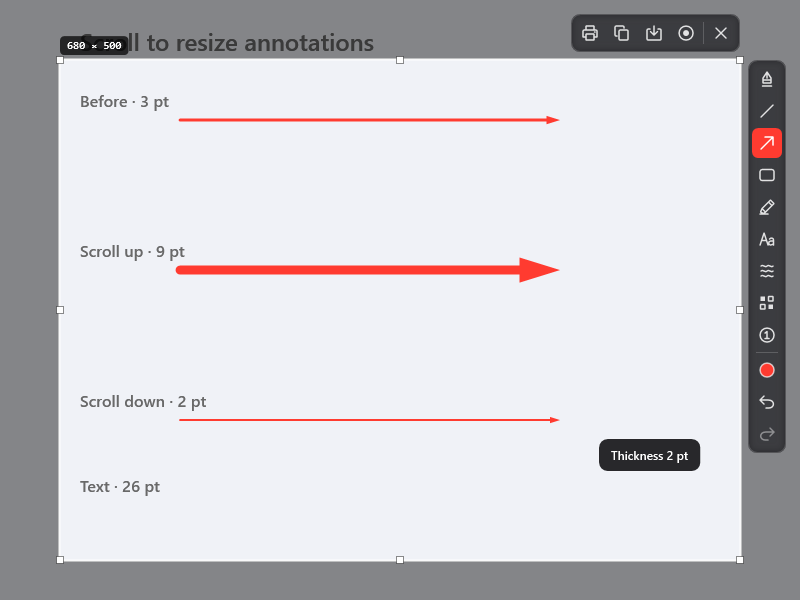

Text and the native video annotation canvas:

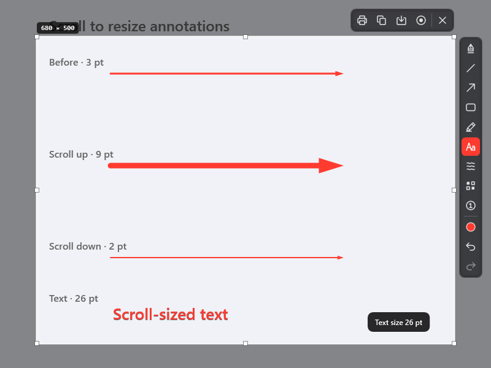

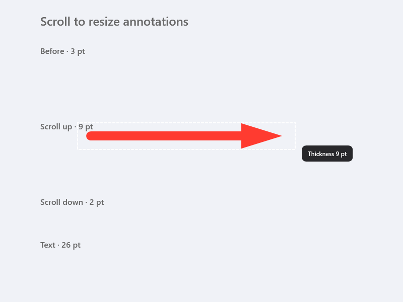

The [native report](windows-validation.json) and
[extracted portable app report](windows-portable-validation.json) are preserved
here. The full run passed, including real recording, video editor, 4K export,
portable app and installer lifecycle checks.

## Checks

- `swift test`: 63 tests in 17 suites pass, including native overlay scroll,
  history/palette/draft preservation, zoom-aware video width and text sizing,
  bounds, ignored tools and accumulated precise motion.
- `swiftlint --strict --quiet --no-cache`: passes.
- `Scripts/bundle.sh`: release build and signature verification pass.
- `.NET` core checks: 439 pass, including 17 new wheel sizing checks.
- Windows Release cross-build: zero warnings or errors.
- `python3 Scripts/generate_ui_icons.py --check`: all 20 icons pass.
- `python3 -m unittest discover -s Tests -v`: 24 tests pass.

Visual evidence complements these checks. Physical trackpad gestures and every
mouse's hardware scroll settings were not manually tested.
