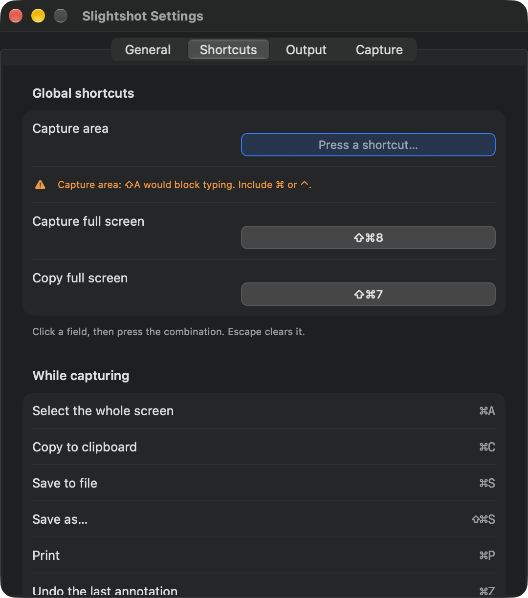
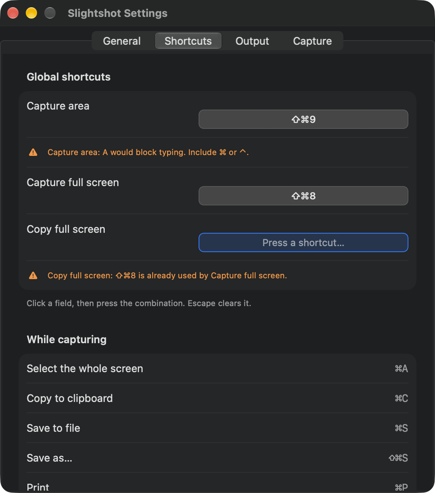
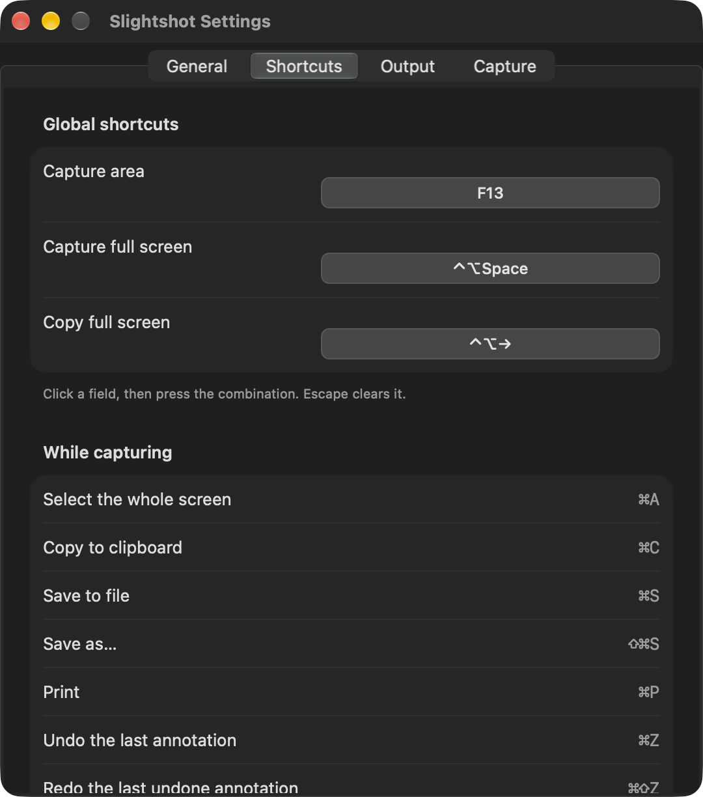

# Shortcut validation

Issue [#43](https://github.com/jmpijll/slightshot/issues/43).

Settings refuses a global shortcut that cannot work and says why under the
field. The previous shortcut stays saved. Settings refuses three kinds:

- A character key with no modifiers or with only Shift, Option or both, such as
  A or ⇧A. It would take that character from every app. Function keys F1 to F20
  may be used without modifiers.
- A shortcut that another Slightshot action already uses.
- A shortcut that `RegisterEventHotKey` refuses.

Escape is the only way to clear a shortcut. A saved shortcut that fails to
register shows the same warning under its field. Global shortcuts are released
while a field is recording, so pressing ⌘⇧9 records it instead of starting a
capture. Menu items now use AppKit key equivalents for function keys, Space,
Return, Delete, Escape and arrows.

Hotkeys register non-exclusively, as before this change. A shortcut that macOS
also uses, such as ⌘Space, saves without a warning, as it did before.

## macOS native evidence

Captured on macOS 27.0.1 arm64 on 20 October 2026 from source `7ac08f4`. The app
was built with `Scripts/bundle.sh`. The review copy has its own bundle identifier
(`com.jmpijll.slightshot.review43`), no update feed or URL scheme, and an ad-hoc
signature. Its preferences were deleted before and after the run. It ran with a
separate home folder for the command inbox, so the user's Slightshot session was
untouched.

The interaction is automated. `review_driver.m` is injected with
`DYLD_INSERT_LIBRARIES`. It opens the production Settings window, clicks the
production recorder fields and posts key events into the app's own event queue.
`run_review.sh` captures the Settings window after each step. The driver also
reports Screen Recording as granted, so the copy does not open the first-run
permission prompt. Nothing is captured from the screen.

Capture area, after pressing ⇧A. The field keeps listening:

Then a bare A. Before the fix this cleared the shortcut, because key code 0 with
no modifiers is stored the same way as a cleared shortcut:

Copy full screen, after pressing ⇧⌘8, which Capture full screen already uses:

Accepted shortcuts: F13 alone, ⌃⌥Space and ⌃⌥→:

## Recorded results

`validation.json` records the stored settings after every step and these checks
from the running app:

- The Shift-only, bare-key and duplicate rejections left the stored shortcuts at
  their defaults. ⌘Space saved as `49:256`.
- While the Capture area field recorded, the driver registered ⌘⇧9 exclusively in
  the same process with status `0`, so Slightshot had released it. After Return
  ended recording, the same probe returned `-9878` (`eventHotKeyExistsErr`), so
  Slightshot held it again.
- After accepting the three shortcuts, the production status menu has these key
  equivalents: Capture Area `0xF710` (`NSF13FunctionKey`, no modifiers),
  Capture Full Screen `0x0020` (Space, ⌃⌥), Copy Full Screen `0xF703`
  (`NSRightArrowFunctionKey`, ⌃⌥). Before this change they were `f13`, `space`
  and an arrow glyph, which AppKit cannot use as key equivalents.

`ShortcutValidationTests.anotherAppsExclusiveHotKeyDoesNotBlockRegistration` covers
contention. A `python3` helper process holds a combo exclusively. Slightshot still
registers it, and keeps it after the helper exits.

A standalone Carbon probe on the same Mac found the following. Same-process
duplicates fail with `-9878`. A combo another process registered, even
exclusively, still registers non-exclusively. A bare F13 registers.
