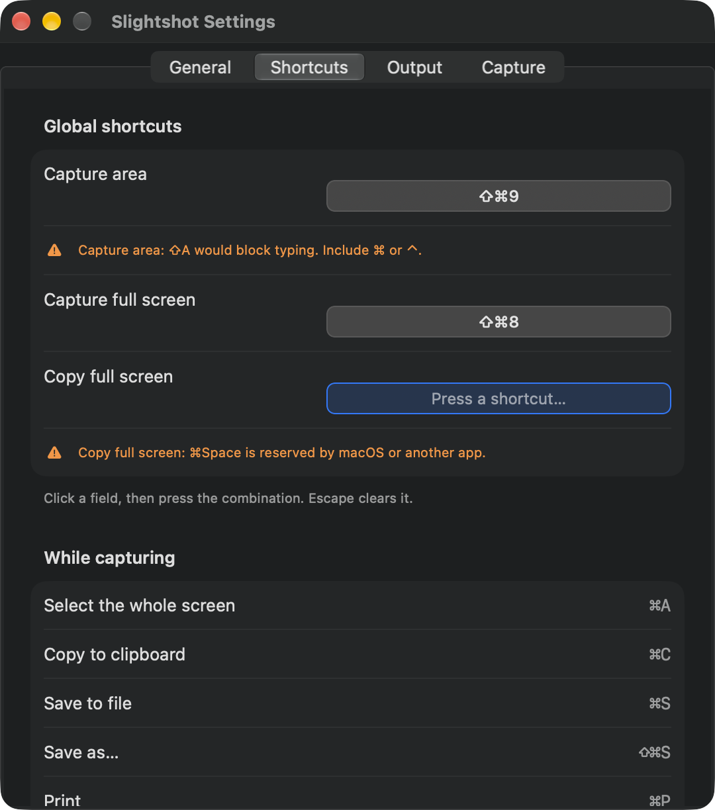

# Shortcut validation

Issue [#43](https://github.com/jmpijll/slightshot/issues/43).

Settings refuses a global shortcut that cannot work and says why under the
field. The previous shortcut stays saved. Settings refuses three kinds:

- A character key with only Shift, Option or both, such as ⇧A. It would take that
  character from every app. Function keys F1 to F20 may be used without modifiers.
- A shortcut that another Slightshot action already uses.
- A shortcut Carbon refuses to register. Slightshot now registers hotkeys
  exclusively, so macOS-reserved shortcuts such as ⌘Space fail at registration.
  Before, Carbon accepted them, but they never fired.

A saved shortcut that fails to register at launch (for example, one another app
claimed exclusively) shows the same warning under its field. Global shortcuts
are released while a field is recording, so pressing ⌘⇧9 records it instead of
starting a capture. Menu items now use AppKit key equivalents for function keys,
Space, Return, Delete, Escape and arrows.

## macOS native evidence

Captured on macOS 27.0.1 arm64 on 20 October 2026 from source `00ac96f`. The app
was built with `Scripts/bundle.sh`. The review copy has its own bundle identifier
(`com.jmpijll.slightshot.review43`), no update feed or URL scheme, and an ad-hoc
signature. It ran with a separate home folder, so the user's Slightshot session and
settings were untouched.

The interaction is automated. `review_driver.m` is injected with
`DYLD_INSERT_LIBRARIES`. It opens the production Settings window, clicks the
production recorder fields and posts key events into the app's own event queue.
`run_review.sh` captures the Settings window after each step. The driver also
reports Screen Recording as granted, so the copy does not open the first-run
permission prompt. Nothing is captured from the screen.

Capture area, after pressing ⇧A. The field keeps listening:

Copy full screen, after pressing ⇧⌘8, which Capture full screen already uses:

Copy full screen, after pressing ⌘Space, which Spotlight reserves:

Accepted shortcuts: F13 alone, ⌃⌥Space and ⌃⌥→:

## Recorded results

`validation.json` records the stored settings after every step and these checks
from the running app:

- While the Capture area field recorded, the driver registered ⌘⇧9 exclusively in
  the same process with status `0`, so Slightshot had released it. After Return
  ended recording, the same probe returned `-9878` (`eventHotKeyExistsErr`), so
  Slightshot held it again.
- The three rejections left the stored shortcuts at their defaults.
- After accepting the three shortcuts, the production status menu has these key
  equivalents: Capture Area `0xF710` (`NSF13FunctionKey`, no modifiers),
  Capture Full Screen `0x0020` (Space, ⌃⌥), Copy Full Screen `0xF703`
  (`NSRightArrowFunctionKey`, ⌃⌥). Before this change they were `f13`, `space`
  and an arrow glyph, which AppKit cannot use as key equivalents.

A standalone Carbon probe on the same Mac found the following. Same-process
duplicates fail with `-9878`. A combo another process registered still succeeds,
so Carbon cannot detect most conflicts with other apps. ⌘Space and ⌘Tab fail only
with exclusive registration. A bare F13 registers.
