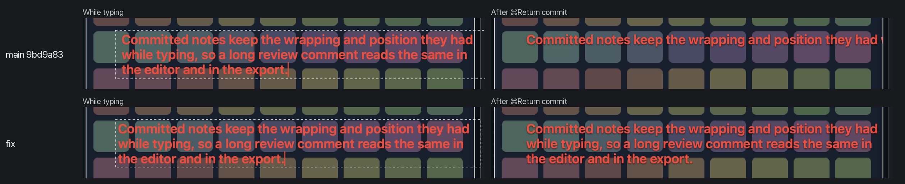
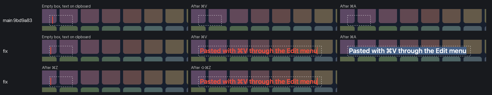
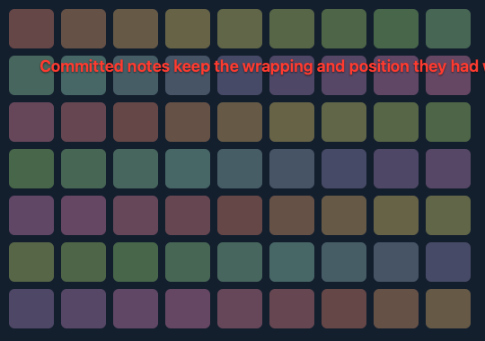
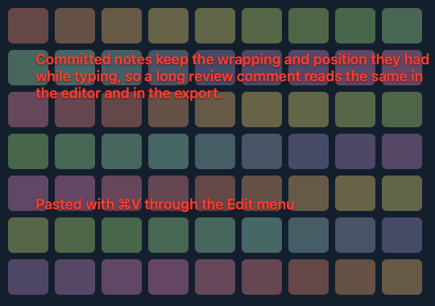

# Text tool: committed layout and editing keys

Issue [#42](https://github.com/jmpijll/slightshot/issues/42).

A committed note now keeps the line breaks and position it had in the text box.
That holds on the canvas, in screenshot exports, in the video preview and in video
exports. The text box and the video editor's time fields get the standard Edit
menu keys: ⌘X, ⌘C, ⌘V, ⌘A, ⌘Z and ⇧⌘Z. The capture overlay keeps its own ⌘A, ⌘C,
⌘X and ⌘Z when no text box has focus.

## macOS native evidence

Captured on macOS 27 on 20 October 2026. The "fix" rows come from source `38f708b`.
The "main" rows come from `9bd9a83` with only the review fixture added. That build
has no Edit menu, as on main. Both are debug builds of the `Slightshot` executable,
launched with `--text-tool-review <dir>`. The bounded fixture opens the production
`OverlayView` and toolbars over a synthetic 900×560 image. It never captures the
desktop, claims the tray, registers hotkeys or requests permission.

The fixture's actions are automated. It places the long note with `insertText`
at an explicit canvas point. Every keyboard step (⌘Return, ⌘V, ⌘A, ⌘Z, ⇧⌘Z, ⌘C) is
a key event sent through `NSApp.sendEvent`, the same routing a real key press
takes, while the app is active and its window is key. The paste text is placed on
the general pasteboard just before ⌘V, and the previous clipboard is restored
right after. The panels are crops of `screencapture -l <window>` images of the
visible window, taken after each step.

Long note while typing, then after ⌘Return. On main the committed note becomes one
line clipped at the selection edge. With the fix it keeps all three lines in place:



Paste, Select All, Undo and Redo in the text box. On main ⌘V and ⌘A do nothing.
With the fix they paste and select through the Edit menu, and ⌘Z and ⇧⌘Z undo and
redo the paste:



The final ⌘C goes to the overlay, not the Edit menu, and produces the export.
Main, then the fix:





Reproduce after `swift build`:

```sh
.build/debug/Slightshot --text-tool-review build/text-tool-review
```

The fixture writes one PNG per step and waits up to 10 seconds per step for an
external `screen-<step>.png` capture. It quits after the export, or after two
minutes.
