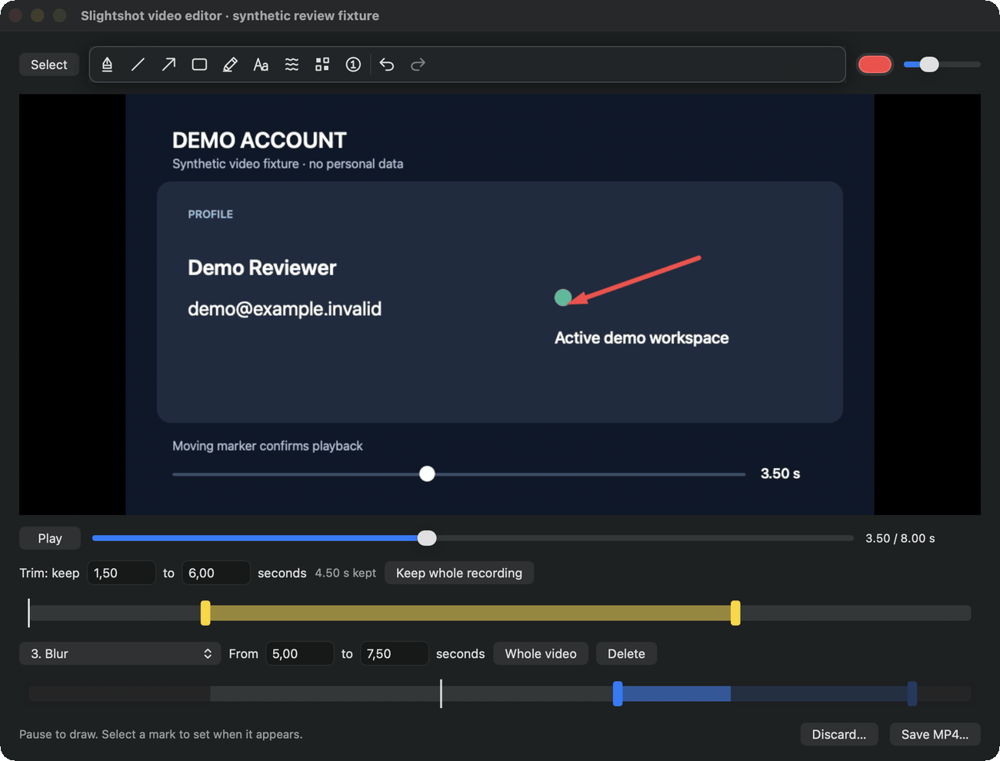
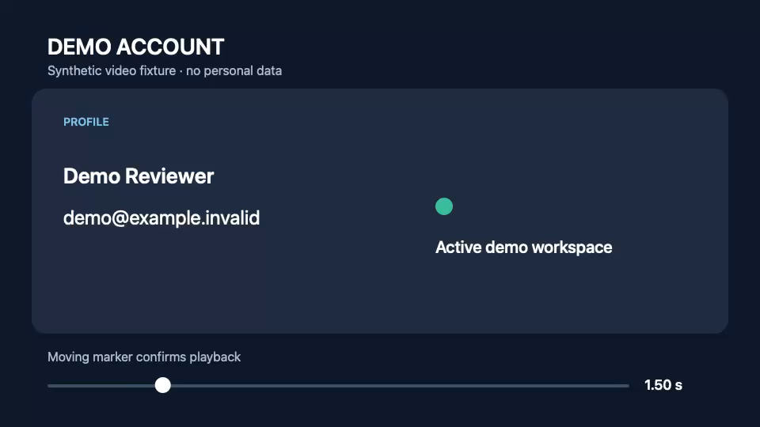

# Recording trim

The recording editor can cut the start and end of a recording before saving.
A yellow two-handle range below the playhead slider and exact **Trim: keep … to
… seconds** fields set the kept part. Defaults keep the whole recording.

## macOS evidence

Captured on 20 October 2026 on macOS 27, Apple silicon, from source commit
`7c3ce7468b0c1aeed6d27f6e0e5a6d43d80de4b2`. The app was built with
`scripts/bundle.sh` and started with
`--video-editor-review <dir> --video-editor-trim-evidence`. The source movie is
the synthetic eight-second, 960 × 540, 24 fps review fixture, with a burned-in
source time stamp. Its account name and address are fixture inputs.

The fixture adds three marks: an arrow at 2–5 s, a "Trimmed out" caption at
0–1 s, and a blur at 5–7.5 s. It then drives the running `VideoEditorWindow`
automatically:

1. Synthetic mouse events drag the start handle to about 1.4 s and the end
   handle to about 6.2 s. The preview follows the handle being dragged.
2. Exact times 1.50 and 6.00 go into the trim fields through their actions.
3. ⌘Z undoes the typed end (back to 6.20) and ⌘⇧Z redoes it.
4. A Play click starts at the trim start and stops at the trim end.
5. A Save MP4 click returns the edit, which is exported at all three
   qualities.

The annotation timeline below the trim dims the removed parts. The selected
blur (5–7.5 s) keeps only 5–6 s.

[Window recording of the interaction](mac/mac-trim-demo.mp4) (ScreenCaptureKit,
editor window only, 13 s).

The exported MP4 starts at source time 1.50 s:

## Measured results

[`mac-trim-validation.json`](mac/mac-trim-validation.json) holds every value
measured with AVFoundation in the running app. `ffprobe` reports the same
4.500000 s duration for each export.

| Quality | Duration | Frames | Expected frames |
| --- | --- | --- | --- |
| Small & fast | 4.50 s | 68 | 68 (15 fps) |
| Balanced | 4.50 s | 108 | 108 (24 fps) |
| High quality | 4.50 s | 108 | 108 (24 fps source cadence) |

- Playback samples stayed between 1.501 s and 5.998 s.
- The export's first frame matched source 1.50 s with a mean marker-region
  difference of 3.86. Nearby source times (0, 1, 1.25, 1.75 and 2 s) ranged
  from 7.39 to 9.05.
- The arrow (2–5 s) is absent at export 0.25 s and present at export 2 s
  (source 3.5 s).
- The caption (0–1 s, entirely outside the trim) is not rendered.
- The blur, clipped to source 5–6 s, changes the blurred region at export
  4.25 s (difference 32.5) and not at export 3 s (6.3, codec baseline).

The [high-quality trimmed export](mac/trimmed-high.mp4) is stored with the
evidence.
