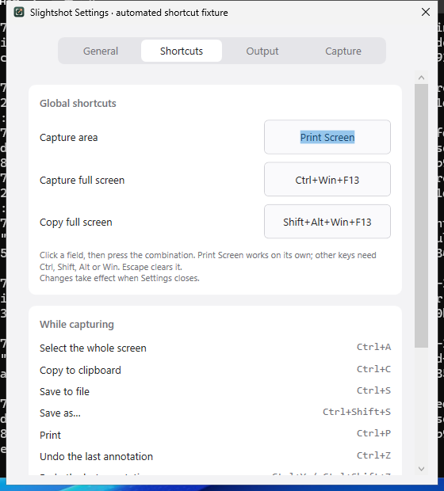
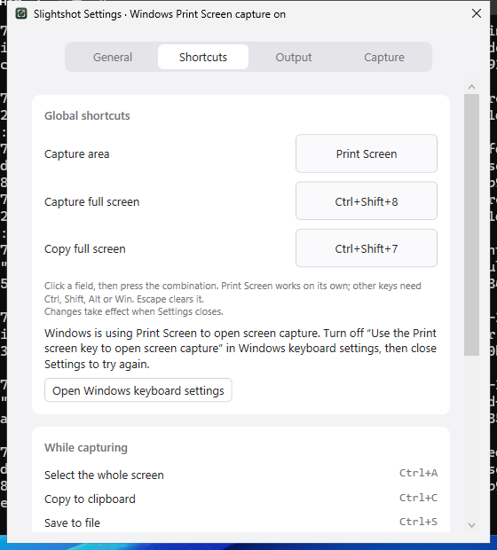

# Windows Print Screen, second launch and error recovery review

Platform: Windows Server 2025 GitHub Actions runner, native WPF app.
Captures come from [Windows workflow run 39412798037](https://github.com/jmpijll/slightshot/actions/runs/39412798037)
for PR head `9af2d7d`. The reports record source `3c29469`, the PR merge
commit that GitHub built. All input is automated: SendInput key presses into
the real Settings fields, real second-launch processes and fixture exceptions.
Fixture settings are created in memory; personal settings are not read or saved.

## Print Screen bound on its own

Windows' "Use the Print screen key to open screen capture" setting was turned
off for this part. Print Screen was pressed in the Capture area field. Windows
delivers only the key-up for Print Screen, and the field records it from that
key-up.

## Windows still using Print Screen

With the setting on, `RegisterHotKey` succeeds but Windows opens its own screen
capture instead. Slightshot reads the setting, reports Print Screen as
unavailable and Settings explains it, with a link to the Windows page.

## Reports

- [Native shortcut report](native-shortcut-validation.json) and
  [portable x64 shortcut report](portable-shortcut-validation.json): every
  shortcut check, including Print Screen recording and registration while bare
  F13 is rejected.
- [Print Screen injection record](print-screen-injection.json): CI cleared the
  setting in the registry, but the running shell kept opening Screen Snipping
  for injected Print Screen and no global callback arrived. The callback needs
  a check with a physical key after turning the setting off in Windows Settings.
- [Native instance report](native-instance-validation.json) and
  [portable x64 instance report](portable-instance-validation.json): second
  launches with no arguments, `--capture-area`, `--capture-full`, `--copy-full`
  and an unknown argument, with exit codes, timings and forwarded commands. They
  also cover a UI-thread exception with an overlay open (one message, overlay
  closed, both errors logged) and a logged unobserved task exception.
