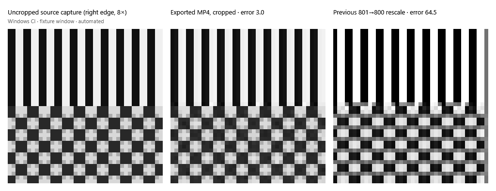

# Windows recording robustness (#46)

Captured by the Windows workflow (run 39414493585) at source commit 32b8ca4.
Platform: Windows Server desktop on GitHub Actions. Input: an automated fixture
window in a separate PowerShell process showing a grey stripe and checkerboard
pattern at 801×451 physical pixels. No person used the app for this capture.

The panels show the right 40×40 pixels of the area, enlarged 8×. The left panel
is an uncropped 801×451 GDI capture of the area. The middle panel is a frame
decoded from the High quality MP4 exported from an 800×450 recording, after
dropping the last column and row. The right panel is the previous StretchBlt
801→800 resample, before encoding. That resample pulls the grey 801st column
into the frame and shifts the stripes.

Native checks from `recording-validation.json`:

- Odd 801×451 area of a separate-process fixture window was cropped to 800×450 (last column and row dropped). The raw GDI recording frame matched an uncropped 801×451 CAPTUREBLT capture exactly (39368 pixels of that composed capture differ from CopyFromScreen on this desktop); the previous StretchBlt 801→800 changed 358870 pixels. After H.264 recording and High export, mean luma error: exported 3.05 (right 100 columns 3.04); previous rescale before encoding 64.46 (right 100 columns 101.12), 358870 of 360000 pixels changed.
- Startup sweep deleted a crashed session (owner lock released) and an old unlocked directory, and left a directory still being created and a live, locked session in place.
- An odd 321×181 selection showed its boundary around the cropped 320×180 capture. Session end during a real recording returned cancel only after the encoder finalized the MP4: the source copied at the moment the handler returned (as if Windows terminated the process then) decoded at 320×180, and the keep marker was already written. The editor then opened; the HUD and editor HWNDs registered the shutdown block reason. A live kept session was never swept and Quit removed it. At the next launch a kept source truncated to 1 KB was deleted without an offer; a playable one was offered: No deleted it, Yes reopened it in the editor under a fresh owner lock, and closing the editor removed it.

The recording boundary is excluded from screen capture by design, so its
cropped 320×180 bounds are verified through the native window rectangle above
rather than shown in a screenshot.

The light corners in the checkerboard come from the CI desktop's composed
(CAPTUREBLT) read, which a recording sees too. CopyFromScreen returned the
pattern unchanged, so the check compares against the same read path.
