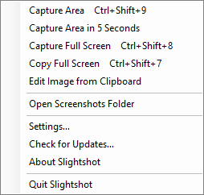
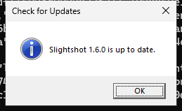
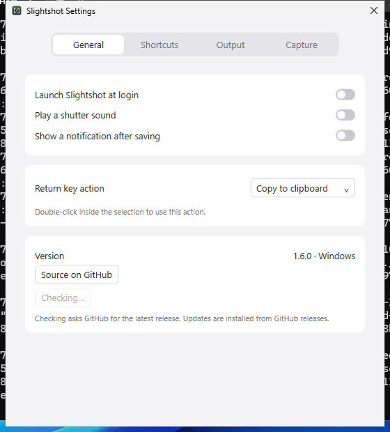
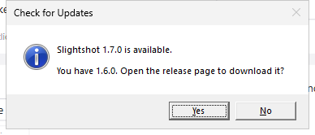
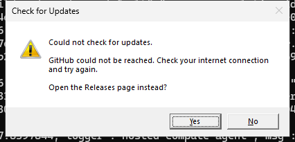

# Windows update check review

These captures are real Slightshot windows and native MessageBoxes on the
isolated Windows Server 2025 CI desktop, cropped to each window. They come from
the `--smoke-test` fixture at source `94c54c7f00d566fa0e05632153474f0839067194`
in [Windows workflow run 39409201439](https://github.com/jmpijll/slightshot/actions/runs/39409201439).

The fixture drives the production tray item and Settings button. It swaps the
HTTP client for a stub, so no request leaves the runner. The stub answers with
fixture releases `v1.6.0` (the running version) and `v1.7.0`, then with a
network failure. Dialog buttons are clicked automatically. The release-page
opener is replaced with a recorder, so clicking **Yes** opens no browser.

The tray menu has **Check for Updates…** where **Download updates…** used to be.

A tray check against fixture release `v1.6.0` reports the running version as current.

The Settings button shows **Checking…** and is disabled while the stub holds the
request. A tray click during that time sends no second request.

Fixture release `v1.7.0` is offered. **Yes** passes its `html_url` to the opener.

A network failure says so and offers the Releases page instead.

The stub recorded three GET requests to
`https://api.github.com/repos/jmpijll/slightshot/releases/latest`. Each had the
User-Agent `Slightshot/1.6.0`, no Authorization header and no body. The full
check list is in [native-validation.json](native-validation.json). The same
fixture also passed against the extracted portable x64 executable.
